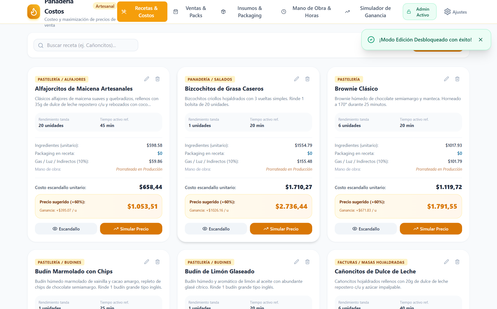
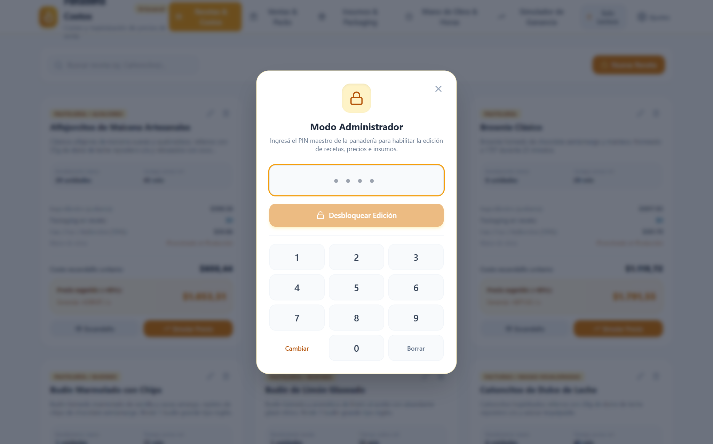
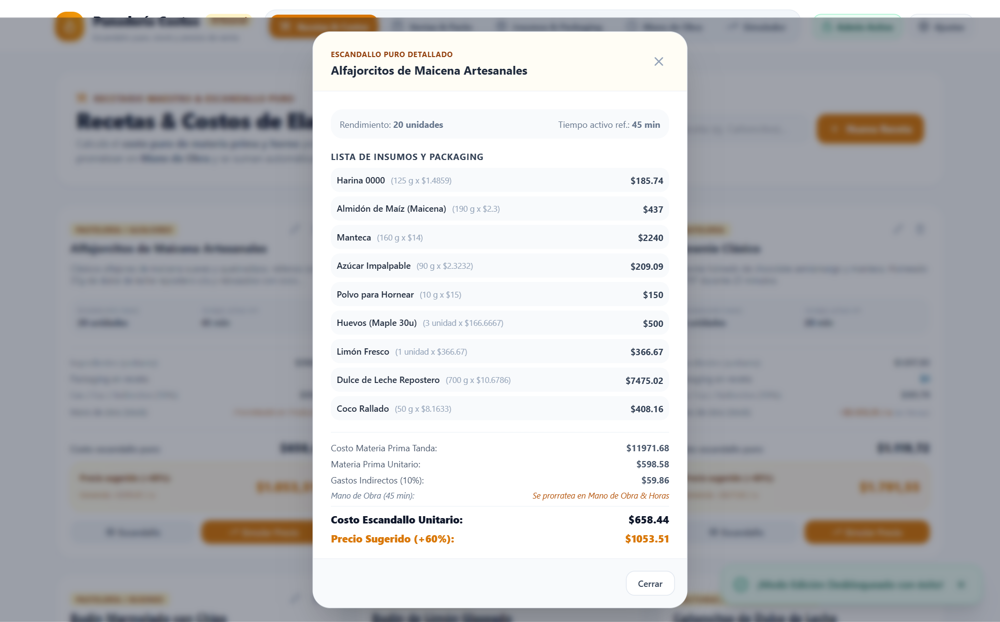
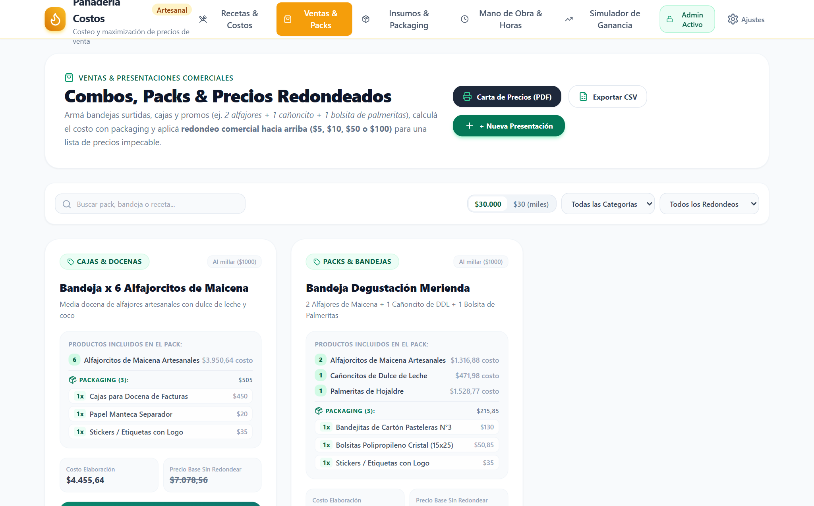
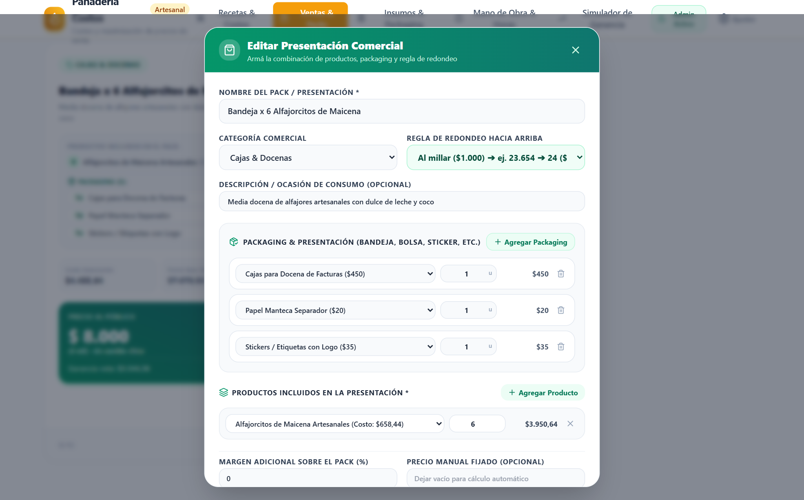
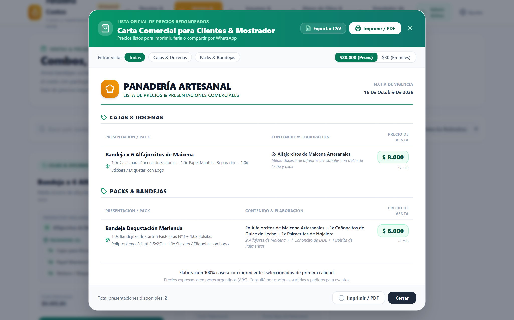
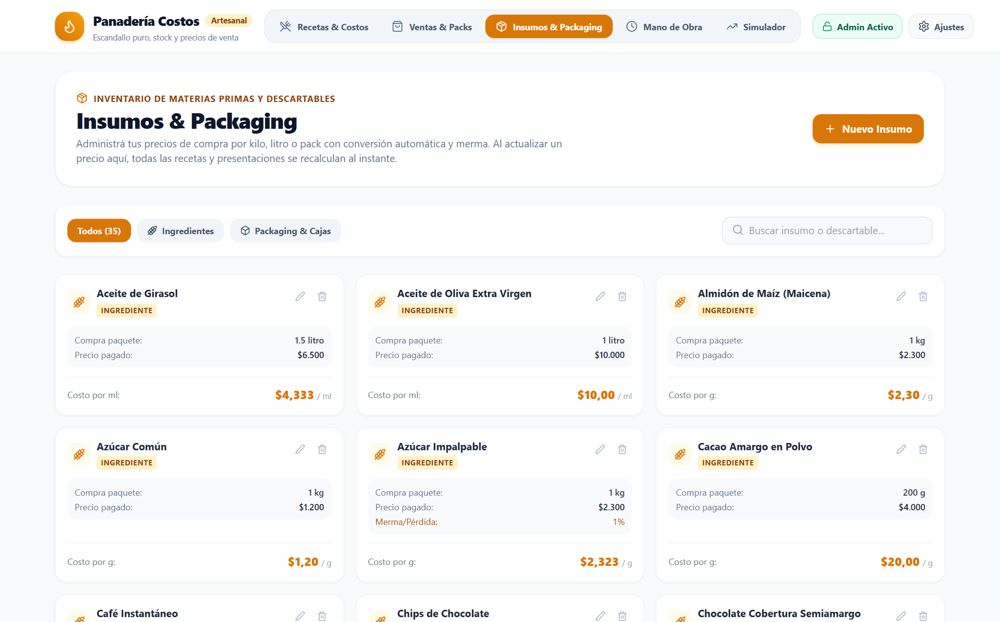
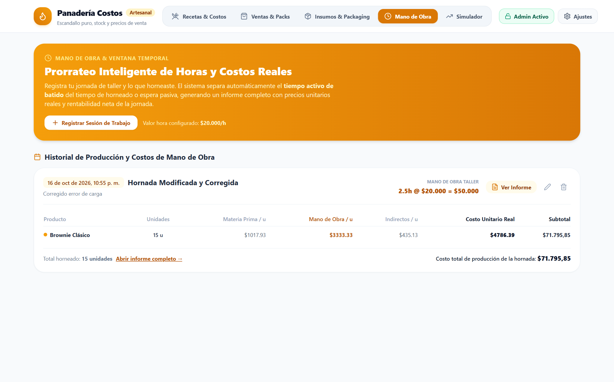
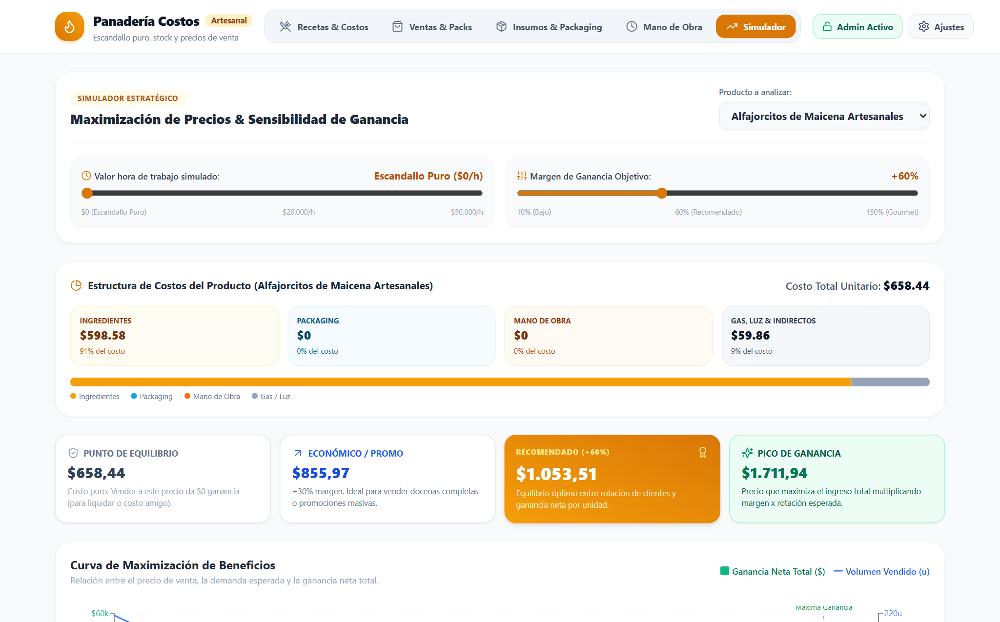
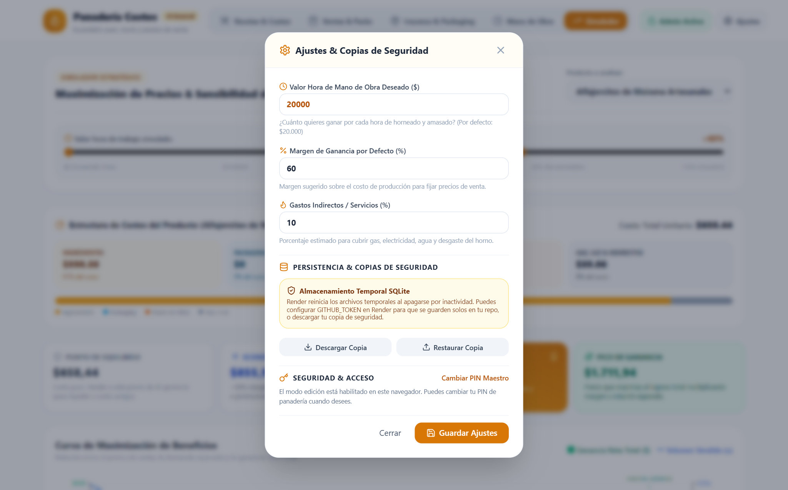

# 📘 Manual de Usuario Integral: Calculadora de Costos & Maximización de Precios

> **Panadería y Pastelería Artesanal**  
> *Versión 3.1 — Guía Oficial de Uso, Escandallo Puro (Modelo A), Mano de Obra Prorrateada desde Stock (Opción 1), Ventas & Packs Multi-Packaging y Redondeo al Millar*

---

## 📑 Tabla de Contenidos
1. [Introducción & Filosofía del Sistema (Modelo A + Opción 1)](#1-introducción--filosofía-del-sistema-modelo-a--opción-1)
2. [Estructura de la Interfaz & Barra de Navegación](#2-estructura-de-la-interfaz--barra-de-navegación)
3. [Seguridad & PIN Maestro (Modo Lectura vs. Admin Activo)](#3-seguridad--pin-maestro-modo-lectura-vs-admin-activo)
4. [Módulo 1: Recetas & Costos (Escandallo Puro)](#4-módulo-1-recetas--costos-escandallo-puro)
5. [Módulo 2: Ventas & Packs (Multi-Packaging, Mano de Obra de Stock y Redondeo al Millar)](#5-módulo-2-ventas--packs-multi-packaging-mano-de-obra-de-stock-y-redondeo-al-millar)
6. [Carta Oficial de Precios e Impresión A4](#6-carta-oficial-de-precios-e-impresión-a4)
7. [Módulo 3: Insumos & Packaging (Materia Prima y Mermas)](#7-módulo-3-insumos--packaging-materia-prima-y-mermas)
8. [Módulo 4: Mano de Obra & Horas (Carga de Stock y Prorrateo Real)](#8-módulo-4-mano-de-obra--horas-carga-de-stock-y-prorrateo-real)
9. [Módulo 5: Simulador de Ganancia & Curva de Sensibilidad](#9-módulo-5-simulador-de-ganancia--curva-de-sensibilidad)
10. [Módulo 6: Ajustes del Taller & Copias de Seguridad](#10-módulo-6-ajustes-del-taller--copias-de-seguridad)
11. [Flujos de Trabajo Prácticos del Día a Día](#11-flujos-de-trabajo-prácticos-del-día-a-día)

---

## 1. Introducción & Filosofía del Sistema (Modelo A + Opción 1)

En la panadería y pastelería artesanal, cargar el valor de una hora completa de trabajo directamente dentro de una receta individual distorsiona los costos cuando el rendimiento de la receta base es pequeño (por ejemplo, *100g de Palmeritas* o *100g de Bizcochitos*), ya que en la cocina real nunca se prende el horno para hacer un solo paquete, sino que se hornea un **stock completo de varios productos en simultáneo**.

Para que tus precios sean competitivos pero **siempre cobres el 100% de tus horas de trabajo**, el sistema funciona en un circuito de 3 pasos (**Modelo A + Opción 1**):

1. **Paso 1 — Recetas & Costos (Escandallo Puro):** Cada receta calcula el costo puro de sus **Ingredientes + Packaging de Receta + Costos Indirectos (Gas, Luz, Horno)**. El tiempo de preparación en minutos queda registrado como ficha técnica.
2. **Paso 2 — Mano de Obra & Horas (Cuando cocinas tu Stock):** Al terminar tu jornada de producción (ej. *4,5 horas de trabajo*), cargas todo el stock que salió del horno. El sistema reparte tu sueldo por hora entre todas las unidades producidas y obtiene la **Mano de Obra Prorrateada por Unidad** (ej. `+$722,22` por alfajorcito, `+$3.249,99` por paquete de palmeritas).
3. **Paso 3 — Ventas & Packs (Donde armas la presentación y cobras todo):** Cuando armas una bandeja, caja o pack para vender, el sistema suma automáticamente:
   $$\text{Costo Puro de Receta} + \text{Tu Mano de Obra Prorrateada (Stock)} + \text{Todos los Packagings del Pack}$$
   Sobre ese costo real completo aplica tu margen de ganancia y **redondea el precio final hacia arriba al múltiplo de \$1.000 más cercano** (por ejemplo, \$29.654,30 pasa a **\$30.000 / \$30 mil**) para que no tengas que lidiar con cambio chico.

---

## 2. Estructura de la Interfaz & Barra de Navegación

La aplicación cuenta con un encabezado superior unificado con navegación por píldoras y diseño adaptable a escritorio, tablet y celular:

### Secciones Principales de la Barra Superior
* **Recetas & Costos:** Recetario maestro con cálculo de escandallo puro e indicador de mano de obra prorrateada en stock.
* **Ventas & Packs:** Constructor de bandejas, cajas y combos con soporte de múltiples packagings, inclusión automática de tu sueldo por hora desde el stock y Carta Oficial de Precios.
* **Insumos & Packaging:** Catálogo de materias primas y descartables con conversión automática (`kg` a `g`, `litro` a `ml`, `pack` a `unidad`) y porcentaje de merma.
* **Mano de Obra:** Registro de jornadas de horneado para prorratear tus horas reales de trabajo entre el stock producido e imprimir informes financieros A4.
* **Simulador:** Curva interactiva de elasticidad precio-demanda y análisis de sensibilidad.
* **Estado de Seguridad (`Admin Activo` / `Solo Lectura`) y Ajustes (`⚙️`):** Control de bloqueo por PIN Maestro y parámetros globales del taller.

---

## 3. Seguridad & PIN Maestro (Modo Lectura vs. Admin Activo)

Para proteger tus fórmulas y precios cuando muestras la pantalla o compartes el enlace web, el sistema cuenta con bloqueo por **PIN Maestro**:

* **🔒 Modo Solo Lectura:** Permite consultar recetas, ver la Carta de Precios y usar el Simulador, pero bloquea cualquier creación, edición o eliminación.
* **🔓 Modo Admin Activo:** Al ingresar tu PIN Maestro (`1234` por defecto), se habilitan todos los botones de edición durante 30 días en tu navegador. Haciendo clic sobre el botón verde **Admin Activo** puedes bloquear la sesión al instante.

---

## 4. Módulo 1: Recetas & Costos (Escandallo Puro)

En **Recetas & Costos** administras la fórmula técnica de cada producto. Al hacer clic en el botón **Escandallo** de cualquier tarjeta, accedes al desglose gramo por gramo de la tanda y de cada unidad:

### ¿Qué muestra cada tarjeta de Receta?

| Indicador | Qué calcula | Ejemplo (*Alfajorcitos de Maicena*) |
| :--- | :--- | :--- |
| **Ingredientes (unitario)** | Suma exacta de materias primas dividida por el rendimiento de la tanda. | **\$598,58 / u.** |
| **Gas / Luz / Indirectos** | Porcentaje (ej. `10%`) sobre la materia prima para cubrir horno y electricidad. | **\$59,86 / u.** |
| **Mano de Obra (Stock)** | Muestra cuánto de tu sueldo por hora absorbe cada unidad según tu última sesión de producción, valor que se suma automáticamente en **Ventas & Packs**. | **+\$722,22 / u.** *(aplicada en Ventas)* |
| **Costo Escandallo Puro** | Suma de Ingredientes + Packaging en receta + Gas/Luz. | **\$658,44 / u.** |
| **Precio Sugerido Base** | Precio orientativo sobre el escandallo puro según el margen configurado (`+60%`). | **\$1.053,51 / u.** |

---

## 5. Módulo 2: Ventas & Packs (Multi-Packaging, Mano de Obra de Stock y Redondeo al Millar)

En **Ventas & Packs** defines las presentaciones reales que entregas a tus clientes (bandejas, cajas por media docena o docena, bolsitas por peso o combos degustación).

### Constructor de Presentaciones con Múltiples Packagings

Al crear o editar una presentación comercial se abre el modal de armado completo:

1. **Packaging & Presentación (`+ Agregar Packaging`):**
   * Puedes sumar **todos los insumos de empaque** que lleva esa presentación: por ejemplo, `1x Caja o Bandeja de Cartón` + `1x Papel Manteca Separador` + `1x Bolsita Polipropileno` + `1x Sticker con Logo`.
2. **Productos incluidos en la presentación (`+ Agregar Producto`):**
   * Seleccionas qué recetas y cuántas unidades integran el pack.
   * Cada producto incorpora automáticamente su **Costo Puro + su Mano de Obra Prorrateada desde tu Stock**.
3. **Cálculo en Vivo y Redondeo Comercial al Millar (`$1.000`):**
   * El panel inferior muestra por separado:
     * **Costo Puro Prod.** (ingredientes y horno)
     * **+ Tu Mano de Obra** (tu sueldo por hora prorrateado desde Stock)
     * **+ Packaging** (suma de cajas, bolsas, papel y stickers)
     * **Costo Total Pack** (la suma de los tres anteriores)
   * Sobre ese total se calcula el precio con ganancia y se **redondea hacia arriba al próximo múltiplo de \$1.000** (ej. \$29.654,30 $\rightarrow$ **\$30.000 / 30 mil**; \$23.654,30 $\rightarrow$ **\$24.000 / 24 mil**).
   * En la tarjeta verde final ves exactamente cuánto dinero queda como **Ganancia Neta del negocio** y cuánto dinero corresponde a **Tu Sueldo (MO)**.

---

## 6. Carta Oficial de Precios e Impresión A4

Al pulsar el botón **"Carta de Precios (PDF)"** en la esquina superior derecha de **Ventas & Packs**, se genera el documento comercial listo para imprimir en una hoja A4 o exportar a PDF:

* **Conmutador de Moneda (`$30.000` vs. `$30 mil`):** Puedes alternar en un clic entre mostrar los precios completos en pesos o abreviados en miles.
* **Impresión A4 Limpia:** Configurada para salir en una única página prolija, ocultando barras y botones del sistema.

---

## 7. Módulo 3: Insumos & Packaging (Materia Prima y Mermas)

En **Insumos & Packaging** cargas las compras de supermercado, distribuidora o papelera. Cualquier cambio de precio aquí actualiza automáticamente todas las recetas y todas las presentaciones de venta.

* **Filtros Rápidos:** Alterna entre **Todos**, **Ingredientes** y **Packaging & Cajas**.
* **Conversión Automática:** Si compras por **Kilo (`kg`)** o **Litro (`l`)**, el sistema divide por `1.000` para obtener el costo exacto por gramo (`g`) o mililitro (`ml`). Si compras por **Pack** o **Docena**, calcula el costo por unidad individual.
* **Merma / Desperdicio (`%`):** Ajusta el costo real contemplando la pérdida inevitable en cocción, pelado o restos en utensilios.

---

## 8. Módulo 4: Mano de Obra & Horas (Carga de Stock y Prorrateo Real)

En **Mano de Obra** registras tus jornadas reales de cocina cuando produces stock:

### ¿Por qué es fundamental este módulo?
1. Cuando horneas varios lotes en una misma mañana o tarde, ingresas las **Horas Trabajadas** y tu **Valor Hora** (ej. `$20.000/h`).
2. Cargas las unidades totales producidas de cada receta en esa sesión.
3. El sistema calcula la **Mano de Obra Unitaria Real** de cada producto según el volumen producido y la dificultad, y **alimenta automáticamente a Ventas & Packs** para que tus precios de venta cubran siempre tu salario por hora.
4. Además, haciendo clic en **"Ver Informe"**, obtienes un reporte financiero A4 imprimible con la **Inversión en Insumos**, **Tu Sueldo de Elaboración** y la **Ganancia Neta de la Jornada**.

---

## 9. Módulo 5: Simulador de Ganancia & Curva de Sensibilidad

El **Simulador** te permite analizar matemáticamente cómo responde la demanda y tu ganancia total ante distintos niveles de precio:

* **Deslizador de Valor Hora Simulado:** Inicia en **`Escandallo Puro ($0/h)`** y te permite deslizar hasta `$50.000/h` para simular distintos escenarios de costo laboral.
* **Deslizador de Margen Objetivo:** Ajusta el porcentaje de ganancia entre `10%` y `150%` viendo en vivo el impacto sobre los 4 hitos de precio (**Punto de Equilibrio**, **Económico/Promo**, **Recomendado** y **Pico de Ganancia**).

---

## 10. Módulo 6: Ajustes del Taller & Copias de Seguridad

Desde el botón **Ajustes (`⚙️`)** del encabezado superior configuras los valores por defecto del taller y gestionas tus respaldos:

* **Parámetros Base:** Valor hora por defecto (`$20.000`), margen de ganancia sugerido (`60%`) y porcentaje de costos indirectos (`10%`).
* **Respaldo y Restauración (`JSON`):** Descarga una copia completa de tu base de datos en cualquier momento o restaura un archivo previo con un clic.

---

## 11. Flujos de Trabajo Prácticos del Día a Día

### 🥖 Flujo Completo: Cocinaste el sábado y vas a publicar tu lista de precios
1. **Registra tu jornada de Stock:** Entra a **Mano de Obra**, toca **"Registrar Sesión de Trabajo"**, pon las horas totales que trabajaste y anota cuántas unidades sacaste de cada producto (ej. *30 alfajorcitos, 24 cañoncitos, 4 paquetes de 100g de palmeritas*).
2. **Revisa tus bandejas en Ventas & Packs:** Entra a **Ventas & Packs**. Verás que cada pack ya sumó automáticamente el costo puro de los ingredientes + **tu mano de obra prorrateada de esa sesión** + todos los packagings (caja, bolsa, papel manteca, sticker), redondeando el precio final hacia arriba al múltiplo de **\$1.000**.
3. **Imprime o comparte tu Carta de Precios:** Haz clic en **"Carta de Precios (PDF)"**, elige si prefieres ver los valores como `$15.000` o `$15 mil`, e imprime o guarda el PDF para enviarlo por WhatsApp.
